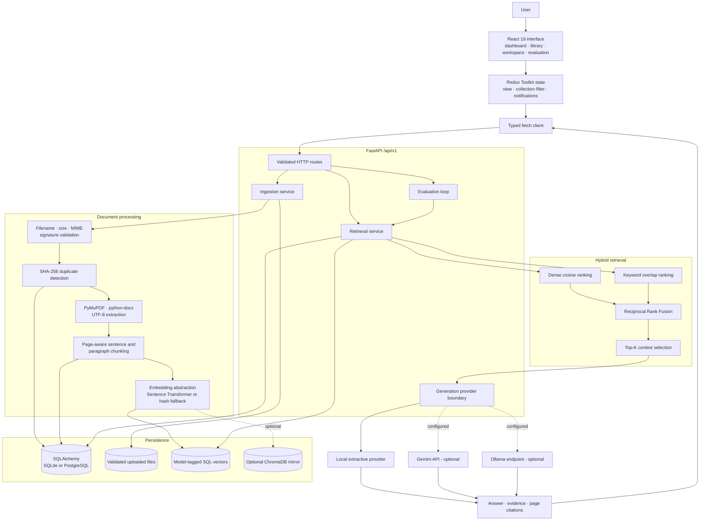
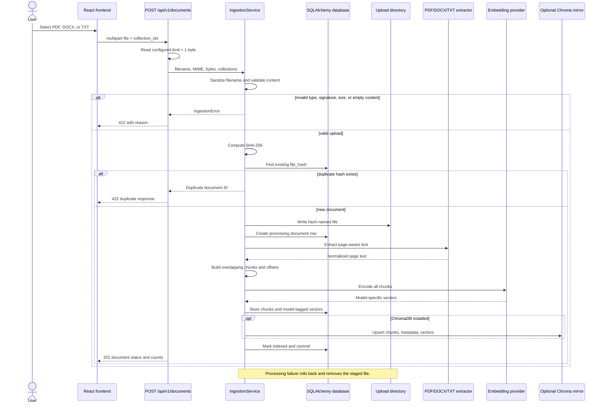
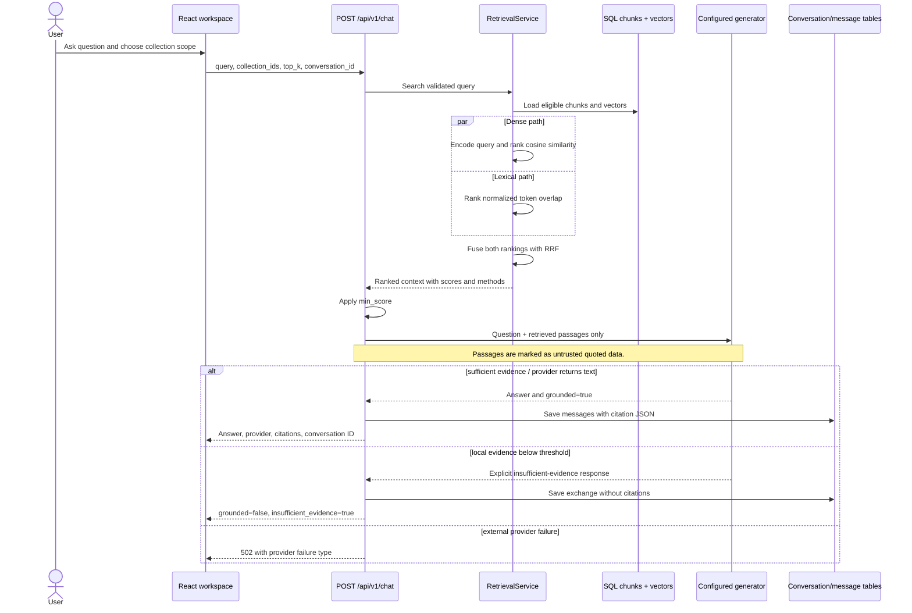

# RAG Document Intelligence

## An Evidence-Oriented Document Retrieval and Reasoning System

[](https://www.python.org/)
[](https://fastapi.tiangolo.com/)
[](https://react.dev/)
[](https://www.typescriptlang.org/)
[](.github/workflows/ci.yml)

RAG Document Intelligence turns PDF, DOCX, and TXT files into a searchable evidence base. It validates and extracts documents, preserves source metadata, builds overlapping chunks, performs hybrid semantic and lexical retrieval, and returns answers with the passages that support them.

The engineering focus is not simply “chat with a PDF.” Retrieval can be inspected independently from answer generation; vectors are tied to the embedding model that produced them; ungrounded questions receive an explicit insufficient-evidence response; and retrieved text is treated as untrusted data rather than as instructions.

> [!NOTE]
> This repository is a portfolio-scale engineering implementation. Its verified local path is documented below; it does not claim production readiness or unverified model, container, database, or performance results.

**Navigate:** [System map](#system-map) · [Ingestion](#document-ingestion-lifecycle) · [Question answering](#question-answering-lifecycle) · [API](#http-api-surface) · [Run locally](#local-development) · [Verification](#verified-engineering-evidence) · [Limitations](#project-boundaries)

---

## Why this system exists

Ordinary keyword matching is useful when a query repeats the vocabulary of a document, but it is weak when the same idea is expressed with different words. Semantic embeddings address that gap, yet dense retrieval can overlook exact identifiers and terminology. This project therefore ranks chunks in two independent ways and combines the rankings with Reciprocal Rank Fusion (RRF).

Retrieval alone is not enough. A generated answer can sound convincing while being unsupported, so the API returns source identifiers, document names, page numbers where available, excerpts, retrieval methods, and scores. If the local extractive generator cannot find sufficiently relevant evidence, it refuses instead of manufacturing an answer or citation.

### Engineering characteristics

| Area | Implemented behavior |
|---|---|
| Input controls | Size, extension, MIME, signature, empty-content, filename, and extraction validation |
| Ingestion | PDF via PyMuPDF, DOCX via `python-docx`, UTF-8 TXT, page-aware chunking and configurable overlap |
| Identity | SHA-256 content hash plus a unique database constraint for duplicate rejection |
| Embeddings | Sentence Transformers adapter with deterministic 256-dimensional hash fallback |
| Persistence | SQLAlchemy metadata, chunks, conversations, messages, and model-tagged JSON vectors |
| Retrieval | Cosine dense ranking, normalized token-overlap ranking, and RRF with rank constant 60 |
| Generation | Local extractive default; configurable Gemini and Ollama adapters |
| Evidence | Structured excerpts with document/chunk IDs, page number, score, and retrieval methods |
| Analysis | Collections, summaries, vocabulary comparison, conversation persistence, and measured retrieval evaluation |
| Interface | React 19, Redux Toolkit, TypeScript, Vite, responsive document and evidence workflows |

## System map

The frontend calls versioned FastAPI routes. Application services perform validation, extraction, embedding, retrieval, and generation. SQL is the source of truth; ChromaDB is an optional persistent mirror rather than a required dependency.



### Architectural boundaries

- **Presentation:** React renders dashboard metrics, document management, answer/evidence views, retrieval inspection, and evaluation. Redux stores navigation and collection-selection state; component state owns request data and loading/error states.
- **HTTP API:** FastAPI exposes contracts under `/api/v1`; Pydantic constrains query length, top-K, score threshold, collection names, and evaluation input.
- **Processing:** `IngestionService` owns upload validation, extraction, chunk creation, embedding, persistence, rollback, and file cleanup.
- **Persistence:** SQLAlchemy stores relational metadata and vectors. The default is SQLite; a PostgreSQL URL can be supplied with the optional driver.
- **Retrieval:** `RetrievalService` performs collection-aware dense and keyword ranking, then fuses ranks before generation.
- **Generation:** one provider interface selects extractive, Gemini, or Ollama behavior from environment configuration.
- **Evaluation:** user-supplied questions and expected document IDs produce actual Recall@K, Precision@K, MRR, and mean retrieval latency; the repository does not ship fabricated scores.

## Document ingestion lifecycle



PDF extraction records one-based page numbers. DOCX and TXT content is represented without a page number because those formats do not provide a stable page boundary in this implementation. Chunks retain `chunk_index`, `char_start`, and `char_end` for inspection.

## Question-answering lifecycle



Conversation IDs allow subsequent chat turns to be appended to the same persisted conversation. The current API does not expose conversation browsing or automatically use prior messages as generation context.

## Retrieval engineering

### Dense semantic retrieval

The active embedding provider encodes the query. SQL stores each chunk vector as JSON alongside `model_name` and `dimensions`. Retrieval loads eligible chunks and calculates cosine similarity as the dot product of normalized vectors; negative values are clamped to zero. This is an explainable linear scan, not an approximate nearest-neighbor performance claim.

The default declared provider is Sentence Transformers with `sentence-transformers/all-MiniLM-L6-v2`. If it cannot initialize, the application reports degraded mode and falls back to a deterministic 256-dimensional token-hash embedding. Tests explicitly select that fallback, so they require no model download.

### Lexical retrieval

The query and chunk text are lowercased and tokenized with `[a-z0-9]+`. Lexical relevance is the number of distinct query tokens present in a chunk divided by the number of distinct query tokens. It is intentionally lightweight and is not BM25 or full-text search.

### Reciprocal Rank Fusion

For each method, the implementation considers up to `max(top_k × 4, 20)` ranked chunks and adds:

```text
RRF contribution = 1 / (60 + rank)
```

The fused order is truncated to top-K. Its normalized RRF value is then multiplied by `0.65 × dense_score + 0.35 × keyword_score`. This second factor preserves absolute relevance so an unrelated chunk does not become meaningful merely because it ranked first in weak result lists.

Collection filtering is applied in SQL before ranking. API responses expose which methods contributed to each result. `min_score` is applied by the route after retrieval.

## Generation and evidence policy

| Mode | Activation | Behavior | Verification boundary |
|---|---|---|---|
| Extractive | `GENERATION_PROVIDER=extractive` | Selects the most query-relevant sentence from up to four passages; refuses below score `0.15` | Default local path covered by tests |
| Gemini | `GENERATION_PROVIDER=gemini` plus key/model | Sends the grounded prompt to Google GenAI | Adapter exists; external call not runtime-verified |
| Ollama | `GENERATION_PROVIDER=ollama` plus endpoint/model | POSTs a non-streaming grounded prompt to `/api/generate` | Adapter exists; external call not runtime-verified |

External-provider prompts state that evidence is untrusted quoted data, must not override system rules, and must not be used to invent citations. This is a meaningful trust boundary, but not a complete defense against all prompt-injection or model failure modes.

Grounded responses contain source objects such as:

```json
{
  "chunk_id": "uuid",
  "document_id": "uuid",
  "document_name": "policy.pdf",
  "page_number": 4,
  "excerpt": "Supporting source text...",
  "score": 0.73,
  "methods": ["dense", "keyword"]
}
```

The extractive provider returns no citations when evidence is insufficient. Gemini and Ollama report whether they returned text; the system does not independently fact-check their prose against every cited passage.

## Persistence model

```mermaid
erDiagram
    DOCUMENT ||--o{ CHUNK : contains
    CHUNK ||--|| CHUNK_VECTOR : has
    DOCUMENT }o--o{ COLLECTION : grouped_in
    CONVERSATION ||--o{ MESSAGE : records
    DOCUMENT {
        string id PK
        string file_hash UK
        string stored_path
        string status
        int page_count
        int chunk_count
    }
    CHUNK {
        string id PK
        string document_id FK
        int chunk_index
        int page_number
        text text
        int char_start
        int char_end
    }
    CHUNK_VECTOR {
        string chunk_id PK_FK
        string model_name
        int dimensions
        text vector_json
    }
    COLLECTION {
        string id PK
        string name UK
        text description
    }
    CONVERSATION {
        string id PK
        string title
    }
    MESSAGE {
        string id PK
        string conversation_id FK
        string role
        text content
        text citations_json
    }
```

SQLite is the zero-configuration default. SQLAlchemy accepts a PostgreSQL connection URL when the optional `psycopg` dependency is installed, but PostgreSQL deployment was not exercised in the recorded audit. Alembic contains the initial migration; application startup also calls `create_all` for local convenience.

The optional ChromaDB adapter creates a persistent collection whose name includes a sanitized model name and vector dimension. SQL remains the metadata source of truth and active retrieval currently reads the SQL vector table; Chroma is maintained as an optional mirror.

## HTTP API surface

Interactive contracts are available at [Swagger UI](http://localhost:8000/docs), [ReDoc](http://localhost:8000/redoc), and `/openapi.json` while the backend is running.

| Method | Endpoint | Important input | Response behavior |
|---|---|---|---|
| `GET` | `/api/v1/health` | — | Database check, providers, degraded/vector-store warnings |
| `GET` | `/api/v1/dashboard` | — | Document, indexed, processing, and collection counts |
| `POST` | `/api/v1/collections` | JSON `name`, `description` | Creates unique collection; duplicate name returns 409 |
| `GET` | `/api/v1/collections` | — | Collections newest first |
| `PUT` | `/api/v1/collections/{id}` | JSON `name`, `description` | Replaces collection fields |
| `DELETE` | `/api/v1/collections/{id}` | — | Deletes collection or returns 404 |
| `POST` | `/api/v1/documents` | multipart `file`, comma-separated `collection_ids` | Validates and indexes; returns 201 or 422 |
| `GET` | `/api/v1/documents` | `offset`, `limit`, optional `status` | Paginated document metadata |
| `GET` | `/api/v1/documents/{id}` | — | One document or 404 |
| `GET` | `/api/v1/documents/{id}/chunks` | — | Ordered text, page, index, and offsets |
| `DELETE` | `/api/v1/documents/{id}` | — | Removes file, SQL data, optional Chroma entries |
| `POST` | `/api/v1/documents/{doc}/collections/{collection}` | — | Adds collection membership |
| `DELETE` | `/api/v1/documents/{doc}/collections/{collection}` | — | Removes collection membership |
| `POST` | `/api/v1/search` | query, collections, top-K, minimum score | Hybrid ranked passages |
| `POST` | `/api/v1/retrieval` | Same as search | Alias exposing the same retrieval behavior |
| `POST` | `/api/v1/chat` | Search fields plus optional conversation ID | Answer, grounding flags, citations, conversation ID |
| `POST` | `/api/v1/summaries/{document_id}` | — | Extractive summary from up to eight chunks |
| `POST` | `/api/v1/comparison` | `document_a`, `document_b` query params | Shared and document-specific terms |
| `POST` | `/api/v1/evaluation` | cases with question/expected IDs, top-K | Recall@K, Precision@K, MRR, mean latency |

Validation errors use FastAPI’s structured 422 response. Missing resources return 404. Generation-provider exceptions are surfaced as 502 without exposing document content.

## Frontend implementation

The Vite application provides five views:

- **Overview:** live dashboard counts and recent documents.
- **Documents:** library status, collection filtering for subsequent retrieval, upload, and deletion.
- **AI Workspace:** question submission, continued conversation ID, answer state, and evidence cards.
- **Retrieval:** generation-independent inspection of passages, scores, methods, and chunk identifiers.
- **Evaluation:** a real single-case retrieval evaluation against a selected expected document.

`frontend/src/api.ts` centralizes typed fetch calls and converts non-2xx responses into visible errors. Components represent empty libraries/evidence, busy operations, upload success, and request failure. `VITE_API_URL` defaults to `http://localhost:8000/api/v1`; production Nginx proxies `/api/` to the Compose backend.

## Local development

### Prerequisites

- Python 3.11+
- Node.js 22+ and npm
- Optional: Docker Engine with Docker Compose
- Optional AI modes: model-download access, Gemini credentials, or a reachable Ollama server

### Windows PowerShell: backend

```powershell
Copy-Item .env.example .env
py -3.11 -m venv .venv
.\.venv\Scripts\Activate.ps1
python -m pip install --upgrade pip setuptools
pip install -e ".[test]"
python -m alembic upgrade head
```

For the deterministic offline path, edit `.env`:

```dotenv
EMBEDDING_PROVIDER=hash
GENERATION_PROVIDER=extractive
```

Start the API:

```powershell
uvicorn app.main:app --reload --host 127.0.0.1 --port 8000
```

Health: `http://localhost:8000/api/v1/health`  
OpenAPI: `http://localhost:8000/docs`

### Linux/macOS: backend

```bash
cp .env.example .env
python3.11 -m venv .venv
source .venv/bin/activate
python -m pip install --upgrade pip setuptools
pip install -e '.[test]'
python -m alembic upgrade head
EMBEDDING_PROVIDER=hash GENERATION_PROVIDER=extractive uvicorn app.main:app --reload
```

Install optional integrations only when needed:

```bash
pip install -e '.[ai]'
pip install -e '.[postgres]'
```

### Frontend

In a second terminal:

```powershell
Set-Location frontend
npm ci
npm run dev
```

Open `http://localhost:5173`. For release validation, run `npm run typecheck` and `npm run build`.

### Docker Compose

```powershell
docker compose config --quiet
docker compose up --build
```

The frontend is exposed at `http://localhost:3000` and the API at `http://localhost:8000`. Configuration validation passed in the recorded environment, but Docker image build and container runtime did not run because its Linux engine was unavailable.

## Configuration reference

Copy `.env.example` to `.env`; never commit the real file.

| Variable | Default in example | Purpose |
|---|---|---|
| `DATABASE_URL` | `sqlite:///./data/rag_intelligence.db` | SQLAlchemy database connection |
| `UPLOAD_DIR` | `./uploads` | Stored validated source files |
| `CHROMA_DIR` | `./chroma_data` | Optional Chroma persistent directory |
| `MAX_UPLOAD_MB` | `20` | Maximum accepted file size |
| `CHUNK_SIZE` | `900` | Approximate maximum chunk characters |
| `CHUNK_OVERLAP` | `150` | Character tail carried into the next chunk |
| `EMBEDDING_PROVIDER` | `sentence-transformers` | `sentence-transformers` or `hash` |
| `EMBEDDING_MODEL` | `sentence-transformers/all-MiniLM-L6-v2` | Sentence Transformer model identifier |
| `GENERATION_PROVIDER` | `extractive` | `extractive`, `gemini`, or `ollama` |
| `GEMINI_API_KEY` | empty | Required only for Gemini; keep secret |
| `GEMINI_MODEL` | `gemini-2.0-flash` | Gemini model identifier |
| `OLLAMA_BASE_URL` | `http://localhost:11434` | Ollama service root |
| `OLLAMA_MODEL` | `llama3.2:3b` | Ollama model name |
| `VITE_API_URL` | `http://localhost:8000/api/v1` | Browser API base |

## Verified engineering evidence

The following results are recorded in [FINAL_AUDIT.md](FINAL_AUDIT.md) for Windows 11, Python 3.11.9, Node 22.23.2, and npm 11.7.0:

| Check | Recorded result | Scope |
|---|---|---|
| Backend suite | **12 passed, 0 failed** | Deterministic unit and FastAPI integration tests |
| Complete API lifecycle | **Passed** | TXT upload → embed/index → chat → citation → delete → cleanup |
| Python compilation | **Passed** | `app` bytecode compilation |
| Python dependency check | **Passed** | No broken installed requirements |
| Strict TypeScript | **Passed** | TypeScript typecheck |
| Frontend production build | **Passed** | Vite build, 41 modules in recorded run |
| Compose validation | **Passed** | Static configuration, not container execution |
| Production npm audit | **0 known vulnerabilities** | Result at audit time; excludes development packages |

Tested behavior includes invalid and empty uploads, PDF signature rejection, page/chunk boundaries, vector dimensions, duplicate hashes, SQL vector persistence, hybrid ranking, citations, unrelated-query refusal, API validation, prompt trust rules, and deletion cleanup.

Not fully runtime-verified: Docker images/containers, Sentence Transformer download, ChromaDB, Gemini, Ollama, PostgreSQL, valid PDF/DOCX fixtures, scanned-document OCR, or large-corpus performance. No throughput, accuracy, or latency result is claimed here.

Repeat the available checks with:

```powershell
python -m compileall -q app
pytest
python -m pip check
Set-Location frontend
npm ci
npm run typecheck
npm run build
npm audit --omit=dev
Set-Location ..
docker compose config --quiet
```

## Decisions and trade-offs

| Decision | Reason | Cost |
|---|---|---|
| Preserve PDF page numbers | Makes evidence navigable and auditable | DOCX/TXT have no stable pages here |
| Combine semantic and lexical ranks | Covers paraphrases and exact terms | Two full rankings increase local work |
| Store model identity with vectors | Preserves provenance and dimensions | JSON vectors are slower than a vector engine |
| Keep SQL as source of truth | Simple transactions and deletion | Current dense retrieval is a linear scan |
| Provide deterministic hash embeddings | Reproducible offline tests | Lower semantic quality than trained models |
| Default to extractive generation | No key, download, or external transfer | Selects sentences rather than synthesizing reasoning |
| Reject SHA-256 duplicates | Avoids redundant indexing | Identical content cannot be intentionally stored twice |
| Treat evidence as untrusted | Keeps document text outside instruction authority | Prompt rules cannot guarantee model compliance |

## Project boundaries

- Image-only PDFs require OCR, which is not implemented.
- Sentence Transformer operation may require a first-run model download and additional memory.
- Gemini and Ollama depend on provider availability, configuration, and model quality.
- SQL vector and keyword retrieval scan eligible chunks in process and are not designed for very large corpora.
- Keyword relevance is token overlap, not stemming, BM25, or language-aware search.
- Evaluation quality depends on the user-supplied expected-document dataset; no benchmark corpus ships with a claimed score.
- Ingestion is synchronous and lacks a durable queue, retry scheduler, or distributed worker.
- Authentication, authorization, tenant isolation, quotas, malware scanning, and encryption-at-rest are not implemented.
- Conversation messages persist, but there is no history/list API and prior turns are not generation context.
- PostgreSQL, ChromaDB, optional model providers, and Docker runtime need environment-specific integration verification.

### Future engineering directions

These are proposals, not current features:

1. Add OCR for scanned PDFs.
2. Evaluate a cross-encoder reranker against a versioned relevance dataset.
3. Cache query embeddings and retrieval results with explicit invalidation.
4. Move ingestion to a durable background job system.
5. Add tracing, metrics, retrieval diagnostics, and provider-cost telemetry.
6. Test PostgreSQL and ChromaDB with containerized integration suites.
7. Add access control, tenant-scoped indexes, quotas, and retention policies.
8. Benchmark larger corpora with recorded hardware, data, parameters, and raw results.

## Repository guide

```text
rag-document-intelligence/
├── app/                         FastAPI application and services
├── alembic/                     Migration environment and initial schema
├── frontend/                    React/Redux/TypeScript UI and Nginx image
├── tests/                       Ingestion, retrieval, security, and API tests
├── .github/workflows/ci.yml     Backend and frontend CI
├── ARCHITECTURE.md              Concise service design
├── API_DOCUMENTATION.md         Route summary
├── DEMO.md                      Evidence-first demonstration
├── EVALUATION.md                Evaluation methodology
├── FINAL_AUDIT.md               Verification evidence and exclusions
├── docker-compose.yml           Local deployment definition
├── Dockerfile                   Non-root backend image
├── pyproject.toml               Package and optional dependencies
└── requirements.txt             Test installation entry
```

## Author

### Shivansh Kumar

**Software Engineer | Systems Engineering | AI & Full-Stack Development | Data and MLOps Engineer**

- Portfolio: [shivanshonline.in](https://shivanshonline.in)
- GitHub: [github.com/shivansh07adi-cloud](https://github.com/shivansh07adi-cloud)

---

Supporting documents: [Architecture](ARCHITECTURE.md) · [API](API_DOCUMENTATION.md) · [Evaluation](EVALUATION.md) · [Demo](DEMO.md) · [Verification audit](FINAL_AUDIT.md)
